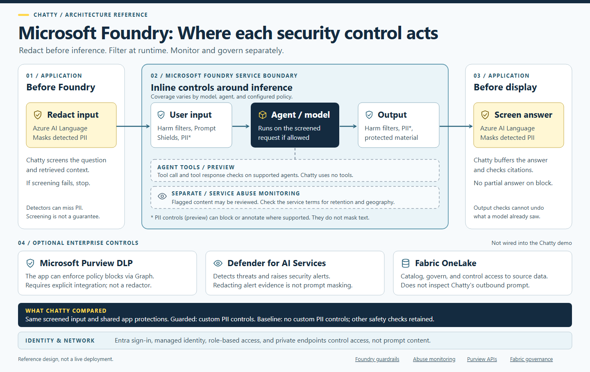
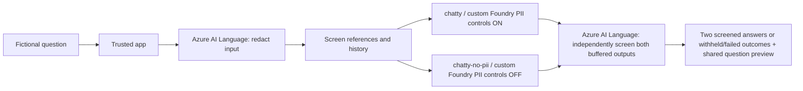
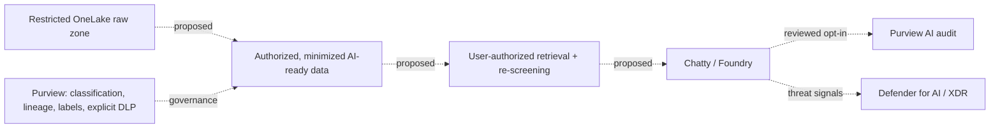

# Handling PII in Microsoft Foundry

This public snapshot documents the original POC's configuration and observations.
It contains no live deployment state. Revalidate availability and enforcement in
your own environment.

**A teaching guide, not a compliance certification.** Use fictional data in
Chatty. Classification is probabilistic: no finding does not mean no PII.
Product documentation checked November 17, 2026 UTC.

Open [architecture.drawio](architecture.drawio) in diagrams.net or the draw.io
VS Code extension. It contains three editable pages: software, deployed Azure
infrastructure, and PII defense in depth. The third page distinguishes the
implemented path from proposed Microsoft security/governance integrations.

The [editable SVG](foundry-security-layers.svg) summarizes where each control
acts, from application-side redaction to Foundry guardrails, abuse monitoring,
and optional enterprise controls.

## The important distinction

**Redaction before inference**, **input blocking**, and **filtering a model's
output** solve different problems. An output filter cannot undo a model having
received sensitive input. Input blocking rejects a request instead of masking
identifiers and continuing.

Chatty explicitly sends text to **Azure AI Language before Foundry**. The browser,
trusted ASP.NET Core process, and Language service briefly process the original
question. The generative model receives the screened version. Screening failures
stop processing; there is no unscreened fallback.

Foundry's [PII concept page][pii] still describes **completions**, while the
preview portal offers User input blocking. Chatty now has verified input
enforcement too: `source: Prompt`, `action: BLOCKING` on policy API `2026-09-01`.
A synthetic email was detected and blocked on the actual pinned `chatty:1`
route before an answer was produced. This is not an input-redaction quickstart
or a claim that every account, region, agent type, or detector behaves identically.
Keep application preprocessing when the requirement is to mask and continue.

The diagram simplifies service calls. The app invokes Language separately for
question, retrieved passages, assembled context, replayed history, and answer.
References are only the bundled original synthetic examples. No reference match
means no model call.

## What is actually configured in this POC?

| Layer | State and boundary |
| --- | --- |
| Input/context/history/output screening | Implemented with Azure AI Language; stop on errors/warnings; no service content logging requested |
| Prompt agents | Version-pinned `chatty` and `chatty-no-pii`; no harness or tools; one shared `src/Chatty.Web/Agent/instructions.md` |
| Foundry safety policy | `ChattyStrict`, attached to `gpt-5-mini`; existing harm and prompt-attack blocking retained |
| Additional Foundry PII input controls | **Enabled:** all 46 categories blocking, including input Name Protection; actual pinned-agent email input blocked; clean and masked controls completed |
| Additional Foundry PII completion controls | **Enabled:** 45 blocking personal-data/secret controls; Name Protection detect-only; synthetic email completion detected and blocked; clean control completed |
| Comparison policy | `ChattyWithoutPii` on matching `gpt-5-mini-no-pii`: same nine non-PII controls, no custom PII controls; mandatory platform safety is not disabled |
| Logging | Application/container logging enabled; stage, count, duration, trace ID, safe error code only |
| Defender for AI, Purview AI integration, OneLake | Described as enterprise extensions below; not configured by this work |

The browser posts one `/api/compare` request. Preparation screens one question
and reference set; both agents receive the identical screened messages, with no
history. Each buffered answer is independently redacted and citation-checked.
A failed/withheld arm releases no partial text without hiding a successful other
arm; shared preparation failures prevent both calls. The comparison itself does
not store conversation history. Each submission makes up to two model calls.

Each agent's graphical timeline includes the real shared input screening events,
marked as run once, then its own checks. Foundry **input** annotations refer to
already-screened text; **output** annotations concern generated text before final
Language redaction. Missing annotations are not labeled clean.
The baseline is labeled **custom PII controls
not configured**, rather than implying absent PII annotations mean "clean."
Ordinary prompts may yield two allowed answers: shared instructions and
preprocessing already discourage PII. Model wording also varies stochastically;
this is an illustrative comparison, not a paired causal benchmark.

The original configuration attempts used the catalog resource ID
`NameProtection`. Policies require the catalog's **`properties.name`** value,
`Name Protection`, matching Foundry's editor. Correcting that mapping resolved
the rejection on stable ARM API `2025-06-01`; no feature registration, region move,
network change, or relaxed safety policy was required.

`infra/pii-filter-names.json` now lists the 46 accepted policy names, shared by
Bicep and `scripts/Enable-PiiGuardrails.ps1`. The updater retains a separate
before-snapshot, preserves existing controls, and independently reads back all
PII controls plus the active model binding. `ChattyStrict` now has 101 controls:
46 PII/secret input controls, 46 completion controls, and the original nine
harm/prompt-attack controls. The input updater uses a fresh ETag with `If-Match`,
preserves the original 55 controls, and leaves `ChattyWithoutPii` unchanged.
Following POC feedback about unwanted output blocks, **Name Protection is now
enabled but detect-only**. The other 45 PII/secret controls remain blocking, as
do the original nine safety controls. Azure AI Language still screens and masks
all configured PII on both input and buffered output; this is not permission to
display unredacted names or send raw identifiers to the generative model.
This exception uses explicit `action: ANNOTATING` with `blocking: false`
through policy API `2026-03-01`. A boolean-only change read back successfully
but still blocked the synthetic name at runtime; configuration alone was not
accepted as proof. With the explicit action, the private runtime check detected
Name Protection and returned the fictional name without filtering; the
synthetic email remained blocked and the synthetic prompt-agent answer completed.
This Name Protection exception applies to **output only**, not input.

`scripts/Test-InputPiiGuardrails.ps1` separately checks the actual pinned agents.
An input containing a fixed synthetic email, while asking not to repeat it,
returned HTTP 400 with `error.content_filters` reporting prompt-side
`personally_identifiable_information.detected=true`, `filtered=true`, and
`blocked=true`; no answer was returned. The identical baseline input, the clean
guarded input, and the masked guarded input all completed. The private
application smoke also passed with real Language preprocessing, exact shared
screened-input equality, and both pinned agents. This is representative input
enforcement, not detector-recall evidence. The test removes its temporary project
and Language role grants and retains content-free evidence in
`artifacts/input-pii-runtime-verification.json`.

`scripts/Test-PiiGuardrails.ps1` verifies enforcement separately from
configuration. From the private jump box, it calls the same deployed model
through the project's Responses API with `store=false`, no tools, and no
streaming. Output-specific probes ask the model to assemble fictional identifiers
from separate pieces, avoiding an input PII block that would obscure output
enforcement. A clean `PINEAPPLE` completion succeeded. A synthetic email completion
returned an incomplete response with `content_filter`; completion-specific
`personally_identifiable_information` annotations reported `detected=true` and
`filtered=true`, with `blocked=true`. The synthetic address was not returned.
The agent definition contains only `kind`, `model`, and `instructions`, so there
is no agent policy override.

The check temporarily grants the jump-box identity Foundry User on this account,
then removes and verifies removal of that grant. It records only fixed case
names, status/boolean results, and allowlisted filter-category names/paths, never
generated text or detected values. An additional synthetic prompt-agent probe
records the actual agent route without a policy override.
The synthetic-name case separately verifies detection without blocking; this
direct-model probe does not bypass the app's output redaction in normal use.
The script also sends the identical synthetic email probe directly to the
baseline model deployment and requires its completion to return that fixed
synthetic email without a filter stop. This deliberately bypasses application
preprocessing to isolate the output policy; the UI path never bypasses it.
Evidence is in `artifacts/pii-guardrails-verification.json`,
`artifacts/pii-guardrails-runtime-verification.json`, and
`artifacts/comparison-verification.json`. The separate private application smoke
checks actual calls to both pinned agents and exact screened-input equality.

This proves representative output enforcement, **not all 46 detectors' recall**.
A successful PUT alone is not runtime proof. Chatty's main-path smoke checks
intentionally redact before inference; they prove a different boundary and do
not exercise PII-bearing model completions.

Strict output controls can also block synthetic or benign-looking answers. A
routine follow-up was blocked during private publication, so the app distinguishes
that policy decision from other incomplete responses: `foundry_output_blocked`
and a clear UI message. Legacy `/api/chat` returns HTTP 422; `/api/compare` returns
explicit per-agent outcomes in an HTTP 200 envelope. It never displays partial or
blocked text, retries without controls, or treats a blocked answer as a successful
chat response. The user subsequently approved the narrow Name Protection
detect-only exception described above. The private app smoke check accepts only a valid screened
answer or an explicitly identified, safely withheld completion. If the first
answer is withheld, it reports live history/answered-conversation checks as
skipped, not passed; unit coverage remains separate. The direct clean-completion
control is checked separately. Evaluate false positives before choosing
categories for a production workload.

Foundry [guardrail inheritance][guardrails] also matters: a custom agent
guardrail overrides rather than unions with its model's guardrail. Include the
full desired control set in an override and test the actual agent route. Never
assume two assigned policies automatically stack.

## A practical PII handling pattern

1. **Minimize first.** Do not collect an identifier a task does not need. Keep
   raw records out of prompts, URLs, telemetry baggage, and exception messages.
2. **Authorize retrieval before redacting.** A user must be entitled to source
   data before an app reads it on their behalf. Masking does not grant access.
3. **Screen every model-bound surface.** Questions are only one surface: source
   passages, history, system-template substitutions, tool results, summaries,
   embeddings, rerankers, and evaluation datasets also need review.
4. **Fail closed.** Timeouts, service failures, partial detection, and unexpected
   outputs must not lead to an unscreened model call or answer.
5. **Add downstream controls.** Use supported Foundry guardrails and application
   output screening. Buffer a complete answer before publishing it if the
   requirement is no unreviewed output. Do not display tokens and retract later.
6. **Test and monitor.** Measure false negatives/positives with representative,
   synthetic cases and adversarial formats, languages, and indirect identifiers.
   Record safe metadata and investigate policy failures without dumping content.
7. **Set lifecycle rules.** Specify owners, lawful processing basis, access,
   retention, deletion, incident response, and any approved regional boundaries.

Screened data is not automatically anonymous. A narrative can re-identify a
person even after names are removed. A reversible token-to-identity map is still
sensitive data and belongs outside model context under separate authorization.
Chatty has no re-identification map.

## Where Microsoft products fit

### Azure AI Language: an explicit preprocessing service

The [Language PII capability][language] detects entities and returns redacted text.
Use it before generative inference when identifiers should not reach that model.
Choose categories/languages and acceptable confidence/behavior through testing.
The redaction service itself is a data processor with access to the original text.

Chatty disables SDK content diagnostics and requests `DisableServiceLogs=true`.
That is not a claim that memory is securely erased or that every Azure platform
has zero retention. The original text can exist in the browser, HTTP request,
and process memory while processing.

### Microsoft Defender for Cloud / Defender for AI Services

[AI threat protection][defender] adds threat detection and security alerts for
supported AI services, with Defender XDR correlation. Use it to investigate
jailbreaks, suspicious activity, and possible data leakage; use posture management
to review resource configuration and exposure.

**Defender is not a general inline PII scrubber.** An alert does not mean a
request was blocked, and absence of an alert does not establish safety.
The VM's existing MDE extension is separate from the Foundry AI protection plan.

Before enabling an AI plan, review scope and pricing with the subscription
owner/security team. [Onboarding options][onboarding] include prompt evidence and
Purview data security for AI interactions. These are separate data-processing
decisions: prompt snippets or full interaction data can become security/compliance
evidence. Review redaction behavior, access, retention, and residency. This POC
does not enable subscription-wide plans or data sharing as a side effect.

### Microsoft Purview: governance plus explicit policy enforcement

Use Purview for data discovery/classification, cataloging, ownership, lineage,
sensitivity labels, audit, and relevant AI data security posture capabilities.
Choose the integration that solves the actual problem:

| Need | Pattern |
| --- | --- |
| Understand sensitive data and its lineage | Catalog/classify sources, assign owners and labels, maintain reviewed lineage |
| Audit supported Foundry interactions | Review native integration scope and data transfer/retention before enabling |
| Enforce DLP in a custom app | Explicit Purview API or supported Agent Framework middleware integration; handle deny/error before model invocation |
| Prevent source oversharing | Enforce user-specific rights at retrieval; honor supported label/rights policies, not just label names |

The [Purview developer guidance][purview] distinguishes native Foundry audit and
governance from explicit API/middleware-based DLP enforcement. Native audit alone
is not proof of inline prevention. A label in metadata does not automatically
strip PII or enforce authorization in arbitrary custom code.

Native integration can send prompts, responses, and associated metadata from
applications in an enabled subscription to Purview. That is intentionally richer
than Chatty's content-free logs and needs its own approval and retention design.

### Microsoft Fabric / OneLake: govern source data before RAG

OneLake is not a PII filter on the path to a Foundry model. It is a possible
governed source for a future retrieval pipeline.

Use [workspace/item permissions and OneLake security][onelake] to separate
management authority from data access. Restrict raw borrower data; publish a
reviewed, minimized/de-identified dataset for AI use. Apply supported table,
folder, row, and column restrictions. Account for privileged workspace roles:
Admins, Members, and Contributors have broader access than restricted readers.

Use Purview discovery, classification, and lineage where supported to explain
what data the AI-ready zone contains, who owns it, and how it was transformed.
Sensitivity labels communicate and can participate in supported protection
workflows, but do not assume a label masks data or that every compute/query path
enforces identical policies. Verify the actual engine, shortcut, and access path.

An ingestion service using an application managed identity does **not**
automatically preserve the eventual user's permissions. Enforce those permissions
at retrieval and on every derived index. Redact **before embeddings/indexing** if
embedding models should not see the original PII; re-screen retrieved chunks at
runtime. Propagate source updates/deletions and access changes into the index.

All dashed paths above are conceptual extensions, not resources deployed for
Chatty.

## Logging without creating another PII store

Chatty logs stage names, finding/reference/message counts, model-invocation
status, elapsed milliseconds, request trace IDs, and fixed error codes. The
successful request's events share a trace scope. Failures use the same request
trace ID and never attach upstream exception objects.

It does **not** log questions (raw or screened), answers, reference bodies,
entity values, conversation/owner IDs, claims, access tokens, or cookies.
Do not enable request/response-body logging, HTTP debug tracing, or generative
AI content capture just to diagnose a latency issue.

Application/container filesystem logging is enabled on the private App Service.
Linux App Service uses the ARM `httpLogs.fileSystem` switch for container
stdout/stderr capture too; configuring `--web-server-logging off` alongside
`--docker-container-logging filesystem` would turn that shared switch off.
The deployment uses a 100 MB / three-day setting for this filesystem log buffer.
Detailed errors, failed-request traces, HTTP-client diagnostics, and Azure SDK
content diagnostics remain off. The app does not add HTTP-body logging.
Use the Azure portal's **App Service > Monitoring > Log stream**, or an authorized
private SCM/log-stream session from the jump box. Portal/control-plane permissions
alone do not create a network route to private SCM. Logs are operational
diagnostics, not a durable compliance archive. Review the actual captured files,
filesystem rotation, and retention; use a separately approved restricted Azure Monitor destination when a
durable retention policy is needed. No new Log Analytics/App Insights resource or
payload tracing was introduced here.

See [App Service diagnostic logging][logs]. Access remains RBAC-protected; ordinary
Chatty users are not given a raw-log API. The UI shows the exact screened question
to its authorized requester only. The expandable **Shared screening log** and
per-agent **Agent log** show request-scoped events on success and failure: stages,
outcomes, elapsed milliseconds, screening counts, and available guarded Foundry
PII detection booleans. One shared trace ID correlates both arms with server logs.
Both shared and per-agent timestamps use the comparison request's start.
Stage durations require paired start/finish events. Foundry annotations are
recorded when the response arrives; this is not live progress.
Reported token counts also support per-agent model-only retail cost estimates,
with screening, guardrail, and infrastructure charges explicitly excluded.
Missing annotations are
explicitly marked unavailable rather than treated as a clean detection result.
It contains no payloads and exposes no shared history, other users' events, or
App Service log files. Each browser submission starts a new conversation and
replaces the preceding result and events. Refresh or Clear results clears the
UI events too; no earlier conversation ID is sent by the browser.

## Before using real data

Confirm privacy/security approval; source-use rights and user authorization;
model/service data-processing and residency requirements; tested detection
quality; guardrail deployment **and runtime** evidence; retention/deletion;
restricted telemetry; Defender/Purview licensing and data-sharing choices;
incident ownership; and tested failure/recovery behavior. `store=false` and a
private endpoint alone do not prove compliance or blanket zero retention.

## Authoritative references

- [Foundry guardrails: applicability, actions, inheritance][guardrails]
- [Foundry personal data filter: output semantics and categories][pii]
- [Azure AI Language PII overview][language]
- [Defender AI threat protection][defender]
- [Defender/Purview onboarding and data-sharing choices][onboarding]
- [Purview integration for Foundry and custom AI apps][purview]
- [OneLake data security overview][onelake]
- [App Service diagnostic logging][logs]

[guardrails]: https://learn.microsoft.com/azure/foundry/guardrails/guardrails-overview
[pii]: https://learn.microsoft.com/azure/foundry/openai/concepts/content-filter-personal-information
[language]: https://learn.microsoft.com/azure/ai-services/language-service/personally-identifiable-information/overview
[defender]: https://learn.microsoft.com/azure/defender-for-cloud/ai-threat-protection
[onboarding]: https://learn.microsoft.com/azure/defender-for-cloud/ai-onboarding
[purview]: https://learn.microsoft.com/purview/developer/secure-ai-with-purview
[onelake]: https://learn.microsoft.com/fabric/onelake/security/get-started-security
[logs]: https://learn.microsoft.com/azure/app-service/troubleshoot-diagnostic-logs
